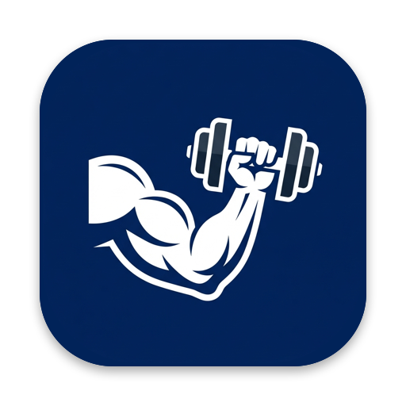
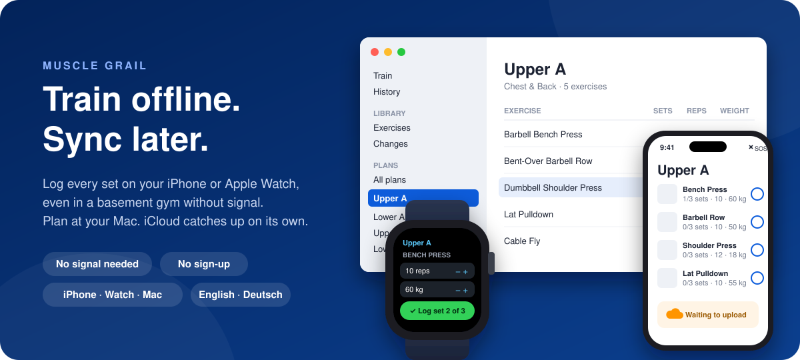
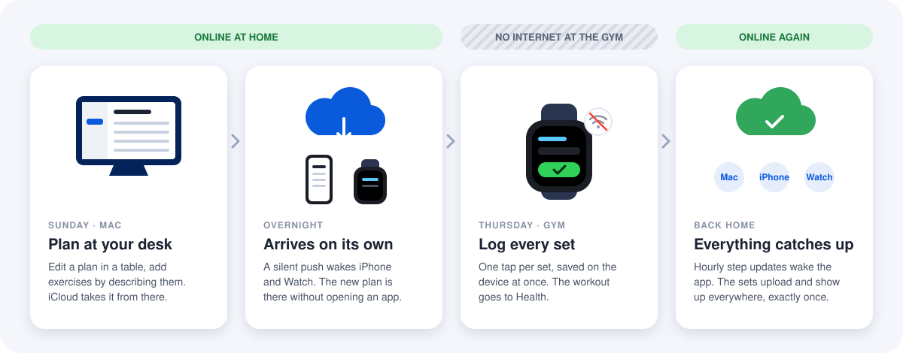
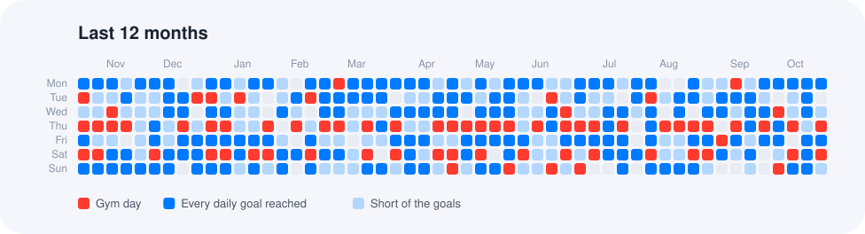

  

<h1 align="center">Muscle Grail</h1>

  <b>The gym tracker that never waits for the internet.</b> 
  Log every set on your iPhone or Apple Watch, plan at your Mac, and let iCloud catch up on its own.

  iPhone · Apple Watch · Mac &nbsp;|&nbsp; iOS 26 · watchOS 26 · macOS 26 &nbsp;|&nbsp; English · Deutsch

  

## Why Muscle Grail

Most gyms sit in a basement, behind concrete or under a steel roof. Your phone shows no bars, and the tracker app spins, forgets a set, or asks you to sign in again. Muscle Grail is built the other way around: **the gym has no internet, so nothing in the app needs it.**

Every tap answers from the device in your hand. The set you just did is saved before your arm comes down. Back home, your iPhone, Apple Watch and Mac sync through your own iCloud in the background, without you opening anything.

## Who it is for

- **You lift with a plan.** A few routines you rotate through, once or several times a week, and you want logging to be one tap, not a chore.
- **Your gym has no signal.** Muscle Grail never shows a spinner, an error or a login at the rack.
- **You live in Apple's world.** Watch on the wrist or iPhone in the pocket at the gym (either one is enough), and a Mac at home to plan on.
- **You train with a partner.** Share your plans with one invite and keep your own weights and history.
- **You are moving over from GymBook.** Bring your whole history along, and take it back out in the same format.
- **You don't want another account.** No sign-up and no server of ours. Your data stays on your devices and in your own iCloud.

## Goals

1. **Instant, always.** Every action works offline and answers from the local store. Network, sync and heavy work stay out of your way.
2. **Current without being opened.** The plan you edited on Sunday is on your watch on Thursday, even if you never touched it in between.
3. **Nothing lost, nothing doubled.** Sets logged offline on two devices end up everywhere, exactly once.
4. **The right device for each job.** Plans are made at a desk with a keyboard. Sets are logged at the gym with one tap.
5. **Your data is yours.** It lives on your devices and in your private iCloud database, with a full history of every change and a backup you control.
6. **Training never breaks.** Starting a workout, logging and finishing work on every app version, forever. No forced update between you and your next set.

## Offline first, eventually consistent

  

Each device keeps a complete copy of your plans, workouts and history and works on it directly. Devices may disagree for a while, say while your watch is in airplane mode at the gym, but they always end up in the same state once they can talk to iCloud again. That is what *eventually consistent* means here, and the data model is designed so that the end state is the right one:

| Situation | What happens |
|---|---|
| iPhone and Watch both log sets offline | Every set is its own record and is never edited, so two devices can't conflict. All sets show up everywhere, none twice. |
| You edit a plan on the Mac while the watch sits in a drawer | A silent push from iCloud, or the next hourly step update from Health, wakes the watch and pulls the change in. |
| You and your partner both edit a shared plan offline | Both sides end the same, in whatever order the changes arrive. The later rename or reorder wins, and a removal wins over a move. |
| A device runs an older app version | It keeps training and syncing. Only plan editing waits until it is updated. |
| You change your mind | Every plan change is kept in an append-only log. Undo a change, bring a plan back to an old version, or restore a backup on the Mac. |

The app is honest about where things stand. Each device shows **Syncing…**, **Waiting to upload** or when it last synced, and every plan shows a cloud badge once its changes have reached iCloud.

Good to know: swiping the app away in the app switcher, Low Power Mode and turning off Background App Refresh stop background sync until you open the app again.

## Features

### Plan on the Mac

- A Mac app laid out like Apple Music: plans sit in the sidebar like playlists, and a plan opens as a table to edit sets, reps and weight in place.
- A catalog of 650 exercises by [RepDB](https://repdb.co), with illustrations and step-by-step instructions in English and German. Filter by body region, level, equipment and category, or make your own exercise.
- Describe what you want, typed or dictated: "3x10 bench press at 60 kg, then squats". Apple's on-device model adds it, in English or German (needs Apple Intelligence).
- Let Claude build and extend plans through MCP, served by the Mac app on your own machine only and off until you switch it on.
- Every plan says what it trains, like *Chest & Back*, *Leg-heavy* or *Full body*.
- A history of every plan change, with undo, and a restore to any earlier version of a plan.

### Train on iPhone and Apple Watch

- One tap logs a set, or ticks off a whole exercise like "3 × 10 at 20 kg". Swipe to delete.
- Each set is prefilled from the set you just did, else from last time, else from the plan.
- Plans take turns: the one after your last workout comes first as *Next up*.
- Weights step through what your gym really has: dumbbells 20 → 22 kg, barbells in 2.5 kg steps, machines in 5 kg steps. Machines that show pounds switch to lb per exercise.
- How to do each exercise, with your own photo or video link, right in the workout.
- Workouts go to Apple Health; the watch records heart rate and calories. The Mac can run a workout too.

### Train together

Share your plans with your training partner in one invite: all of them, now and later, or just the ones you choose. You each keep your own Apple ID, weights and history. Changing a shared exercise asks whether it is for both of you or only for you, so one of you can do curls while the other benches, at the same spot in the plan.

### See your year

  

One chart shows the last year day by day: gym days in red, and the days you reached your step and distance goals in blue. Strength workouts from any app count. Statistics per week, month, quarter or year show your workouts, sets and volume.

### On your wrist and Home Screen

- A watch complication with today's steps and walking distance. Tap it for your day, your workouts and the year at a glance.
- An iPhone widget for the Home Screen and the Lock Screen, with a ring toward your daily goal.

### Coming from GymBook

On the Mac, import GymBook's log export: match its exercises to the catalog once, and every workout arrives with its sets, and every routine as a plan. Importing the same file again adds nothing. Export writes your history back in GymBook's format.

## Privacy

- No account, no ads, no analytics, no server of ours.
- Plans, workouts and history sync through your private iCloud database. Shared plans travel through CloudKit sharing between your Apple ID and your partner's.
- The plan assistant runs on your Mac with Apple's on-device model. The Claude connection listens on your Mac only and is off by default.
- On the Mac, a backup of everything goes to a folder you pick. Restoring it brings every device back to that state.

## Status

Version 1.0 is in development and not on the App Store yet. To try it, build it yourself.

## Build it yourself

Open `MuscleGrail.xcodeproj` and follow **First run** in [PLAN.md](PLAN.md). The watch app and complication ship inside the iPhone app.

Core tests: `cd Core && ./fetch-catalog.sh && swift test`. The exercise catalog is downloaded at build time, not committed: its license forbids republishing it.

[PLAN.md](PLAN.md) holds the design decisions, the known risks and the acceptance tests. [CHANGELOG.md](CHANGELOG.md) lists what each version does.

## Credits

Exercise data by [RepDB](https://repdb.co) ([exercise-dataset](https://github.com/RepDB/exercise-dataset), free tier, used under its [data license](https://github.com/RepDB/exercise-dataset/blob/main/LICENSE-DATA.md)).
